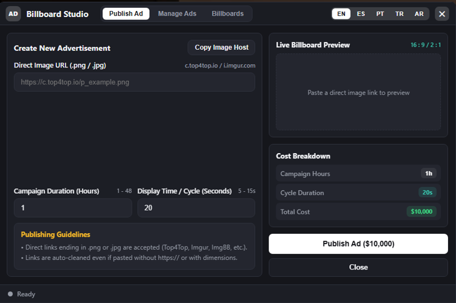
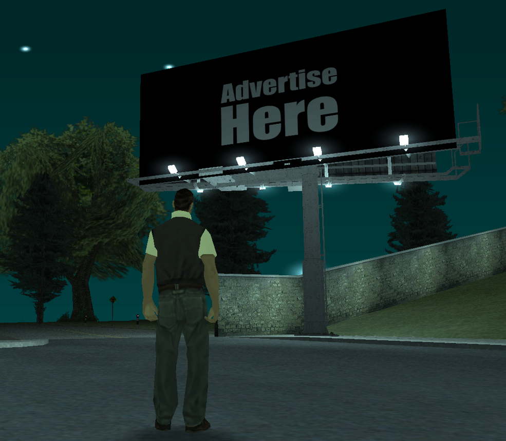
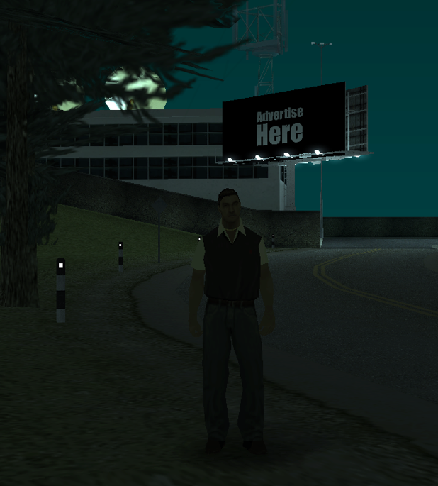
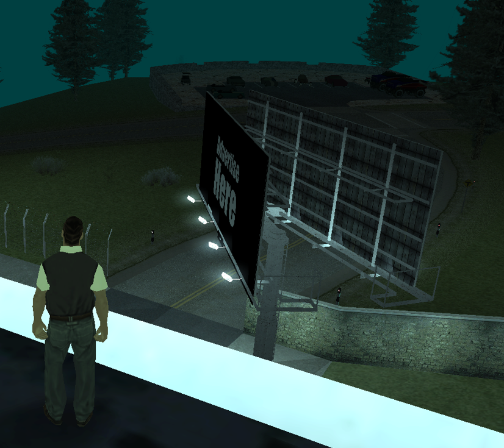
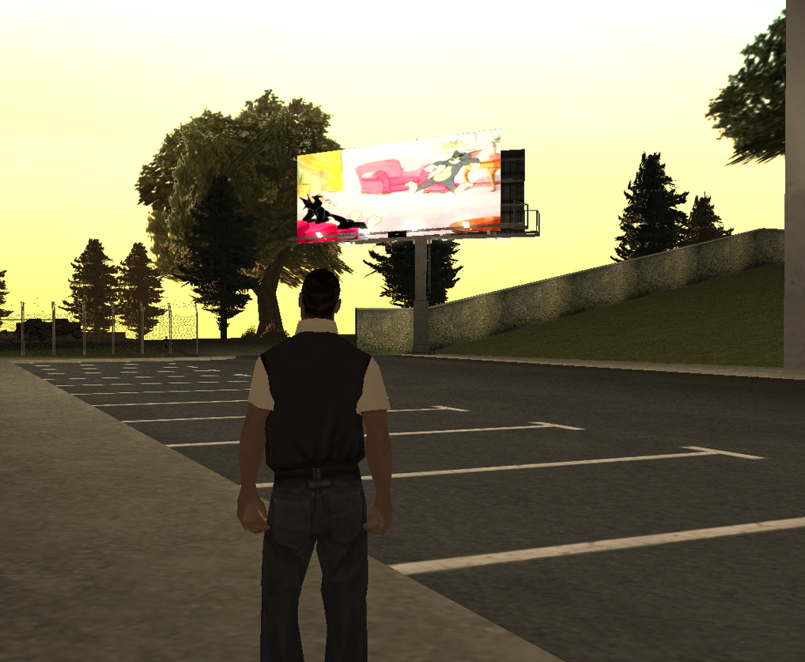

# Billboard Ads

مورد إعلانات للوحات داخل لعبة **Multi Theft Auto: San Andreas (MTA:SA)**. يرسل اللاعبون الإعلانات للمراجعة، ويتولى الطاقم المصرّح له إدارة الحملات واللوحات من خلال واجهة CEF.

**الإصدار:** `1.0`

## المميزات

- يستطيع اللاعبون إرسال إعلانات صور لمراجعتها من الطاقم.
- يستطيع الطاقم قبول الحملات أو رفضها أو إيقافها مؤقتًا أو استئنافها أو حذفها.
- تظهر الإعلانات المقبولة على اللوحات داخل اللعبة.
- إدارة الحملات واللوحات من خلال واجهة الإدارة أو الأمر `/billboards`.
- إنشاء لوحة في موقع الموظف الحالي أو باستخدام إحداثيات دقيقة والدوران والـ Interior والـ Dimension.
- تحديد اللوحات الموجودة وتعديلها ونقلها وتدويرها والانتقال إلى مواقعها أو حذفها.
- تخزين البيانات باستخدام SQLite.
- التحقق من الصلاحيات والصور على السيرفر، وتحديد معدلات الطلبات والتحكم في معاينات الصور.
- لغات الواجهة: الإنجليزية والعربية والإسبانية والبرتغالية والتركية.

## التثبيت

1. انسخ **محتويات** مجلد `resource` إلى مجلد باسم `billboard-ads` داخل مجلد `resources` الخاص بسيرفر MTA.
2. امنح المورد صلاحية `function.fetchRemote` من خلال ACL.
3. نفّذ الأوامر التالية في كونسول السيرفر:

   ```text
   refresh
   start billboard-ads
   ```

يمكن للاعب التفاعل مع موظف الإعلانات والضغط على **E** لإرسال إعلان. ويستطيع الطاقم المصرّح له استخدام `/billboards` من أي مكان.

ينشئ المورد ملف `billboards_data.db` تلقائيًا. احتفظ بنسخة احتياطية منه قبل تحديث المورد.

## الإعدادات

عدّل الملف `resource/config.lua` للتحكم في أسعار الحملات ومدتها، وحدود الصور، والدومينات المسموح بها، والحد الأقصى للحملات واللوحات، ومجموعات ACL، وموقع موظف الإعلانات، واسم أمر الإدارة.

- `AdminACLGroups`: صلاحية إنشاء اللوحات وإدارتها، مع فحص `command.kick` الحالي.
- `ModeratorACLGroups`: صلاحية مراجعة الحملات الإعلانية.
- `AdminPanelCommand`: اسم أمر الإدارة، والافتراضي `billboards`.

صلاحية مراجعة الإعلانات لا تمنح تلقائيًا صلاحية إنشاء اللوحات أو نقلها أو حذفها. امنح صلاحيات البناء للموظفين الموثوقين فقط.

## تحديد مواقع اللوحات

يمكن للموظف إنشاء لوحة في موقعه الحالي أو إدخال X وY وZ والدوران والـ Interior والـ Dimension يدويًا. كما يمكن تحديد لوحة موجودة وتعديلها أو نقلها أو تدويرها أو الانتقال إلى موقعها أو حذفها.

الحدود الافتراضية:

- X/Y: من `-3000` إلى `3000`
- Z: من `-1000` إلى `2000`
- Rotation: من `0` إلى `360`
- Interior: من `0` إلى `255`
- Dimension: من `0` إلى `65535`

## الصور وأمان الشبكة

- استخدم رابطًا مباشرًا لصورة PNG أو JPEG، وليس رابط صفحة أو ألبوم أو عارض صور.
- يتحقق السيرفر من الرابط ومحتوى الصورة الفعلي؛ امتداد الملف وحده غير كافٍ.
- اترك قائمة الدومينات المسموح بها مفعّلة على السيرفرات العامة. أضف الدومينات الموثوقة من `AllowedDomains` في `resource/config.lua`.
- التحويلات الخارجية معطّلة؛ استخدم الرابط النهائي المباشر للصورة.
- الحدود الافتراضية: حجم `2 MiB`، عرض `2048 px`، ارتفاع `1024 px`، وإجمالي `2 مليون` بكسل.
- توجد حدود لطلبات المعاينة والكاش ونقل الصور لتقليل استهلاك الموارد.

لا تعطّل `EnforceDomainWhitelist` على سيرفر عام إلا إذا كنت مدركًا للمخاطر الأمنية.

## الصور

### لوحة الإدارة



### موديل لوحة الإعلانات









## فيديو الشرح

[مشاهدة فيديو Billboard Ads على YouTube](https://youtu.be/6wsNU2701aA)

## ملاحظات الأمان

- تعامل مع أحداث العميل ومدخلات CEF على أنها غير موثوقة. يجب تنفيذ فحوصات الصلاحيات والتحقق من البيانات على السيرفر.
- تساعد آلية مراقبة حجم التنزيلات على الحد من استقبال الصور الكبيرة، كما يتم فحص حجم الاستجابة النهائي.
- خذ نسخة احتياطية من `billboards_data.db` قبل تحديث المورد.
- تأكد من حقوق إعادة توزيع الملفات `resource/assets/1916.dff` و`resource/assets/1916.txd` و`resource/assets/1916.col` قبل نشر المورد.

## Credits

By [ams](https://github.com/amsxd) and [s2iz](https://github.com/s2iz).
