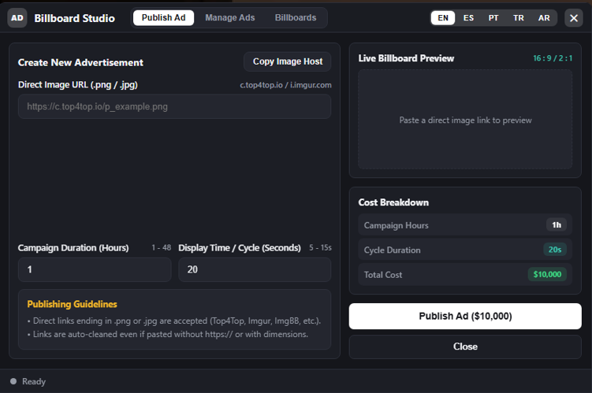
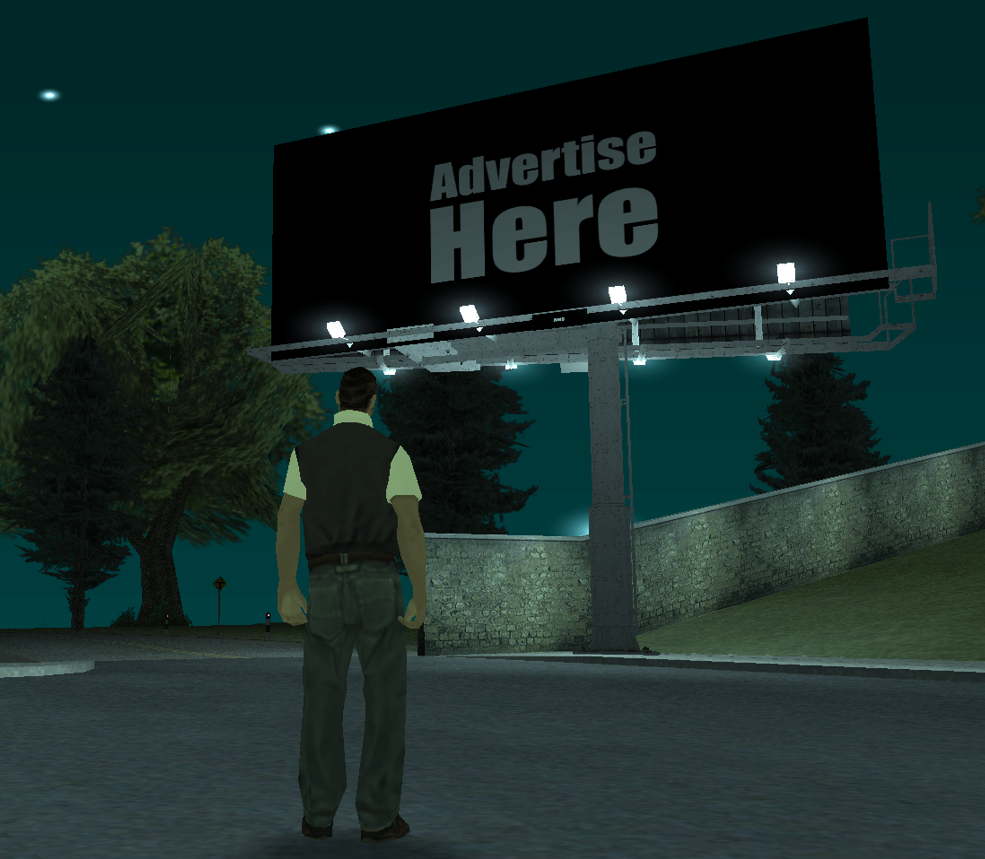
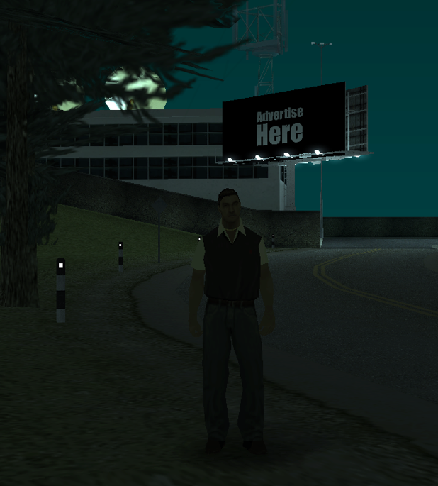
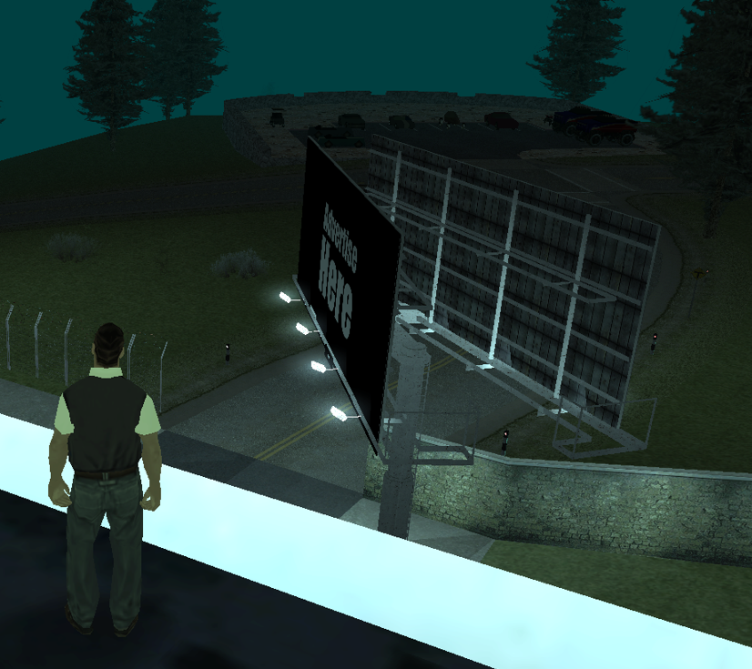
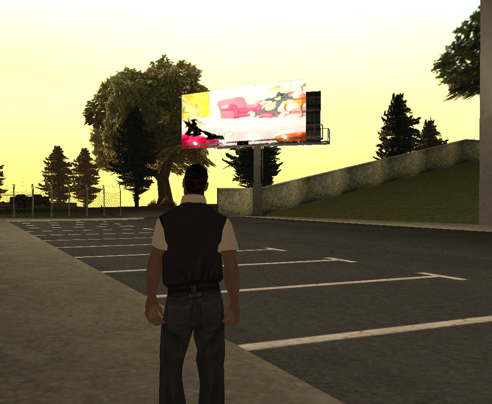

# Billboard Ads

An in-game billboard advertising resource for **Multi Theft Auto: San Andreas (MTA:SA)**. Players submit image advertisements for review, while authorized staff manage campaigns and billboards through a CEF interface.

**Version:** `1.0`

## Features

- Players can submit image advertisements for staff review.
- Staff can approve, reject, pause, resume, and delete campaigns.
- Approved advertisements are displayed on in-game billboards.
- Manage campaigns and billboards through the staff interface or `/billboards`.
- Create billboards at your current position or using exact coordinates, rotation, interior, and dimension.
- Select, move, rotate, teleport to, and delete existing billboards.
- SQLite database storage.
- Server-side permission checks, image validation, rate limits, and bounded image previews.
- UI languages: English, Arabic, Spanish, Portuguese, and Turkish.

## Installation

1. Copy the **contents** of the `resource` folder into a folder named `billboard-ads` inside your MTA server's `resources` directory.
2. Grant the resource the `function.fetchRemote` permission in your server ACL.
3. Run these commands in the server console:

   ```text
   refresh
   start billboard-ads
   ```

Players can interact with the advertising clerk and press **E** to submit an advertisement. Authorized staff can use `/billboards` from anywhere.

The resource creates `billboards_data.db` automatically. Back up this file before updating the resource.

## Configuration

Edit `resource/config.lua` to configure campaign prices and duration, image limits, allowed image hosts, campaign and billboard limits, staff ACL groups, the clerk position, and the staff command.

- `AdminACLGroups`: billboard creation and management access (also requires the existing `command.kick` check).
- `ModeratorACLGroups`: campaign moderation access.
- `AdminPanelCommand`: staff command name; default is `billboards`.

Moderators cannot automatically create, move, or delete billboards. Grant building access only to trusted staff.

## Billboard placement

Staff can create a billboard at their current position or enter X, Y, Z, rotation, interior, and dimension manually. Existing billboards can be selected and edited, moved, rotated, teleported to, or deleted.

Default placement limits:

- X/Y: `-3000` to `3000`
- Z: `-1000` to `2000`
- Rotation: `0` to `360`
- Interior: `0` to `255`
- Dimension: `0` to `65535`

## Images and network safety

- Use a direct PNG or JPEG image URL, not a webpage, album, or image-viewer link.
- The server validates the URL and actual image data; the file extension alone is not trusted.
- Keep the domain whitelist enabled on public servers. Add trusted hosts through `AllowedDomains` in `resource/config.lua`.
- External redirects are disabled. Use the final direct image URL.
- Default limits: `2 MiB` file size, `2048 px` width, `1024 px` height, and `2 million` pixels.
- Preview requests, caching, and image transfer are bounded to control resource usage.

Do not disable `EnforceDomainWhitelist` on a public server unless you understand the security risk.

## Screenshots

### Staff dashboard



### Billboard model









## Demo video

[Watch the Billboard Ads demo on YouTube](https://youtu.be/6wsNU2701aA)

## Security notes

- Treat client events and CEF input as untrusted. Permissions and validation must be enforced server-side.
- The image-download watchdog helps limit oversized downloads, and the final response is checked against the configured size limit.
- Back up `billboards_data.db` before updating the resource.
- Confirm redistribution rights for `resource/assets/1916.dff`, `resource/assets/1916.txd`, and `resource/assets/1916.col` before publishing the resource.

## Credits

By [ams](https://github.com/amsxd) and [s2iz](https://github.com/s2iz).
